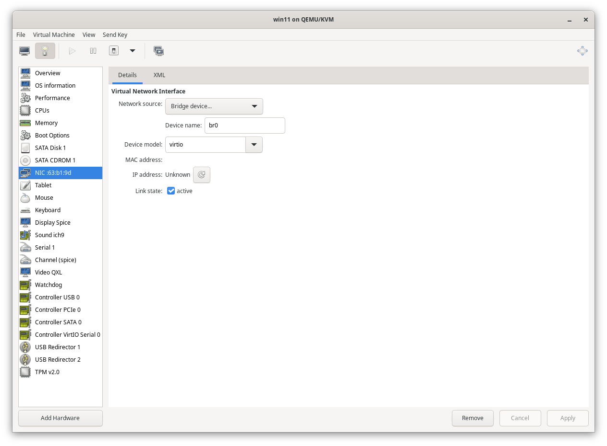
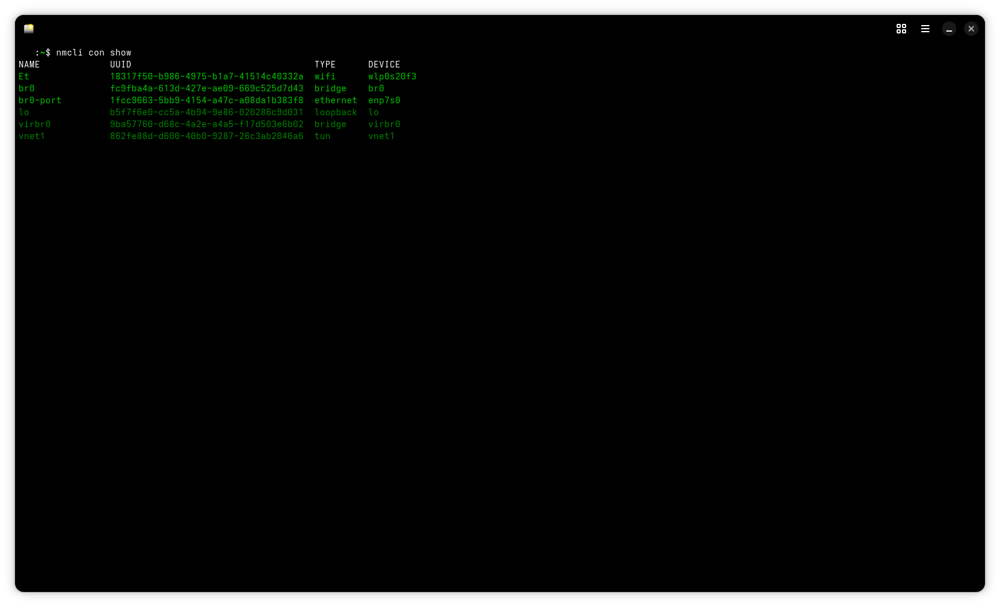
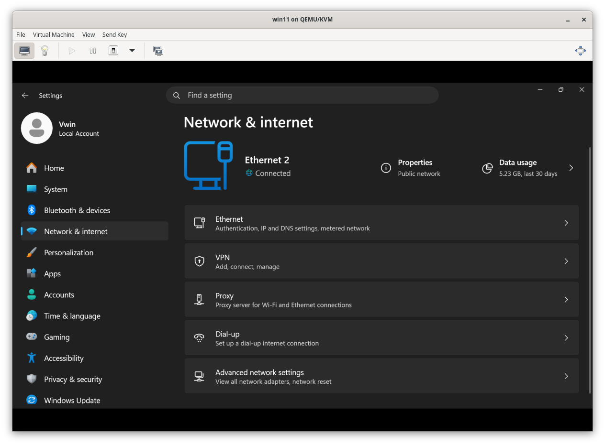

#  Isolated KVM Networking: The Dedicated Ethernet Bridge
> **Scenario:** Give a Windows VM a direct physical line to the internet via Ethernet while keeping the Linux Host isolated on WiFi.
 
> **Tested on:** a Fedora Linux host using KVM, virt-manager and NetworkManager (`nmcli`), with a Windows 11 guest.
 
---
 
# Important NOTE:
 
(`wlp0s20f3`) and (`enp7s0`) are MY interfaces. They will usually be different for you,
so replace `enp7s0` in the commands with the name of your own ethernet interface.
 
***To find the name of your interface, run this***
(`nmcli`)
 
_The name normally begins with `e` (for ethernet)._
 
---
 
##  The Micro-Logic (The Hardware Flow)
| Component | Logical Role | The "What For" |
| :--- | :--- | :--- |
| **`br0`** | Virtual Switch | A network switch that lives in RAM (software). It doesn't have an IP; it just passes traffic between its ports. |
| **`enp7s0`** | Physical Plug | The "Uplink." The physical wire plugged into the wall router. |
| **`vnet0`** | Virtual Cable | The ghost wire that appears when the VM starts, to plug it into `br0`. |
 
---
 
## Step 1: The Linux Host Setup
Follow these steps to build the "Switchboard" and ensure the Host OS doesn't "steal" the connection.
 
### 1. Building the "Switch"
```bash
sudo nmcli con add type bridge ifname br0 con-name br0
```
* **Why:** Think of this as unboxing a physical 5-port network switch. Right now, it's just sitting on your desk (RAM) and isn't plugged into anything yet.
### 2. Freeing the physical port (only if needed)
Run this first:
```bash
nmcli con show
```
If a line like this appears, the host is holding on to your ethernet hardware:
 
***`Wired connection 1  	04b0e...  	ethernet  	--`***
 
Delete it (your host stays online through WiFi):
```bash
sudo nmcli con delete "Wired connection 1"
```
* **Why:** NetworkManager created this "loose" profile on its own, and it keeps the hardware (`enp7s0`) for itself, so it can't become part of the bridge. If you don't see this line, skip this step.
### 3. Connecting the Switch to the Real World
```bash
sudo nmcli con add type ethernet slave-type bridge con-name br0-port ifname enp7s0 master br0
```
* **Why:** This is the "surgery." You are plugging one end of an Ethernet cable into your Laptop's port (`enp7s0`) and the other into your new Virtual Switch (`br0`). We are telling the physical hardware: "You no longer report to the OS. You now report to the Switch (`br0`)."
### 4. Silencing the host (The Isolation)
```bash
sudo nmcli con modify br0 ipv4.method disabled
sudo nmcli con modify br0 ipv6.method disabled
```
* **Why:** You have to tell the host: "Don't use this switch to get an IP for yourself." This leaves the entire "pipe" open for the VM.
* **Why both lines:** NetworkManager also tries IPv6 by default. If you only disable IPv4, the host can still pick up an IPv6 address on `br0`, and then it is not fully isolated.
* If `br0` was already active when you changed these settings, re-activate it so they apply: `sudo nmcli con up br0`
---
 
##  Step 2: Connecting the VM to the Switch
1. Open **Virt-Manager** -> VM Settings.
2. Select the **NIC (Network Interface)**.
3. Set **Network Source** to `Bridge device...`.
4. Type **`br0`** into the Device Name field.
* **The Logic:** This is like taking a virtual Ethernet cable from your Windows 11 VM and plugging it into a spare port on your Virtual Switch (`br0`).

 
---
 
## The WiFi Trap
**Never attempt to bridge a WiFi card (`wlp0s20f3`).**
A WiFi client is only allowed to send frames under **its own** MAC address. The router (access point) will not forward frames that carry a different MAC, like the VM's, unless a special mode (4-address / WDS) is turned on, and most routers don't offer it to normal clients. So the VM would never get an IP from the router. A cable has no such rule. **Always use a cable for bridging!**
 
---
 
# Check that it worked
 
Run this on the host:
```bash
nmcli con show
```
 
## You will see something like this:-
 

 
More checks on the host:
```bash
ip link show master br0
ip -4 addr show br0
ip -6 addr show br0
```
* `ip link show master br0` lists the ports plugged into the switch: `enp7s0`, plus one `vnetX` for each running VM.
* The last two should show **no** address on `br0`, which proves the host is isolated.
## Your ethernet connection on the VM will look like this:-
 

 
## The _IP address_ on the VM should be ***different*** from the host's _IP address_.
 
.png)
 
---
 
## Good to know
* The host has no IP on `br0`, so it can't talk to the VM through the bridge. Traffic between them goes out over WiFi, through the router, and back in through the cable. If the host can't reach the VM, check your router for a setting called "client isolation" or "AP isolation".
* The VM sits directly on your home network, so every device on it can reach the VM. Keep the VM updated and don't leave weak passwords on it.
---
 
## Undo
To go back to the normal setup:
```bash
sudo nmcli con delete br0-port
sudo nmcli con delete br0
```
Then set the VM's NIC back to its old network source in Virt-Manager, and unplug and replug the cable. NetworkManager normally creates a fresh default wired connection by itself.

